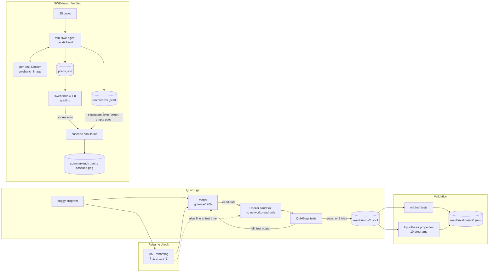
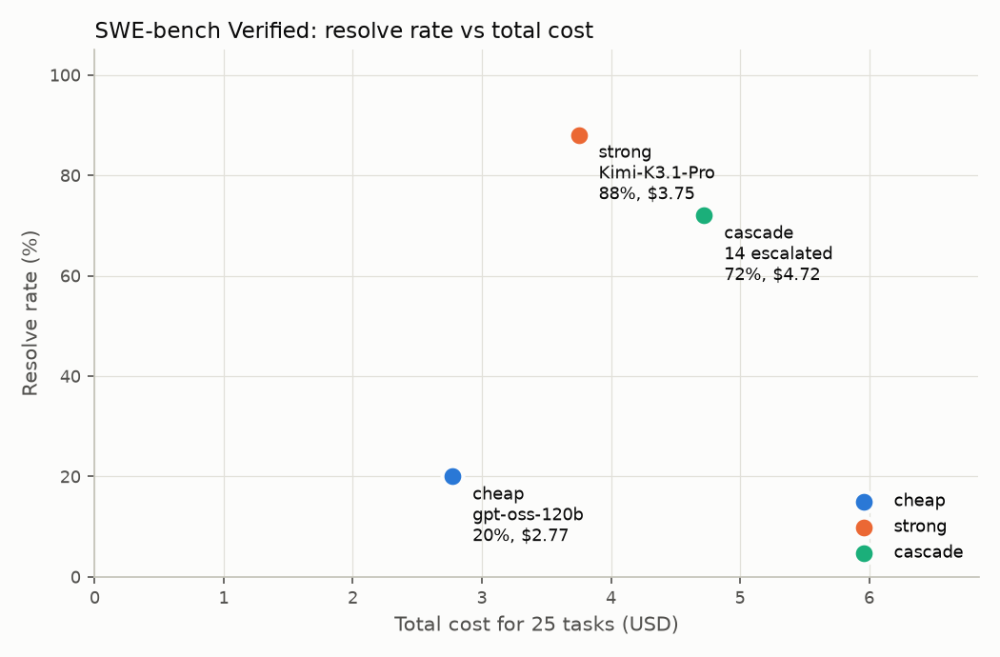

# inferno

Inferno is an LLM agent that repairs buggy programs. It has two parts:

- **QuixBugs:** it fixes the 40 Python programs in a feedback loop, running the tests in a Docker sandbox with no network access. The fixes are then checked with Hypothesis properties, and the whole run is repeated on renamed programs to test for memorization.
- **SWE-bench Verified:** it runs mini-swe-agent on 25 real GitHub issues with a cheap and a strong model, grades the patches with swebench, and simulates sending only the cheap model's failures to the strong model (a cheap-then-strong cascade).

**Headline numbers** (all from committed files in `results/`):

- **QuixBugs, gpt-oss-120b:** 38/40 fixed on the first try, 40/40 within 3 tries.
  - On the 10 programs with properties, the property checks caught 0 wrong fixes.
  - On renamed programs, 34/40 were fixed on the first try.
- **SWE-bench Verified, 25 tasks:**
  - **Kimi-K3.1-Pro** resolved 22/25 for $3.75.
  - **gpt-oss-120b** resolved 5/25 for $2.77.
  - **The cascade** (gpt-oss first, Kimi when gpt-oss hit a limit, errored or returned an empty patch) resolved 18/25 for **$4.72**. It lost to Kimi alone on both counts:
    - The 14 escalated tasks first paid $2.01 for gpt-oss runs that produced nothing usable.
    - Of the 11 gpt-oss patches it kept, only 5 resolve; Kimi resolves 9 of those 11.

## Architecture



## Running it from a fresh clone

You need Docker (on WSL, enable Docker Desktop's WSL integration), [uv](https://docs.astral.sh/uv/), and a Together AI key.

```bash
git clone https://github.com/gaurangsisodiya/inferno.git && cd inferno
uv sync                                   # Python 3.12 venv with all dependencies
cp .env.example .env                      # then set TOGETHER_API_KEY
QUIXBUGS_REF=4257f44 scripts/setup_quixbugs.sh
uv run pytest                             # the agent's own tests (model and Docker mocked)
```

`setup_quixbugs.sh` clones QuixBugs into `data/quixbugs`; `4257f44` is the commit our results used. It also moves the reference solutions out of the repo to `~/inferno-private`, so the agent never sees the answers (see [Keeping the reference solutions private](#keeping-the-reference-solutions-private)).

### QuixBugs: repair, validate, rename

```bash
uv run python -m inferno.loop --program bitcount               # one program, prints the diff + a JSON record
uv run python -m inferno.run_all --run-id gptoss-v1            # all 40 programs
uv run python -m inferno.validate_run --run-id gptoss-v1       # re-check the fixes with tests + properties
uv run python -m inferno.run_all --renamed --run-id gptoss-renamed-v1
uv run python -m inferno.validate_run --run-id gptoss-renamed-v1
uv run python scripts/check_properties.py                      # properties pass on reference, fail on buggy
```

The model defaults to `INFERNO_MODEL`, or `openai/gpt-oss-120b` if that isn't set.

**The repair loop** (`loop.py`):

- It gives the model the program and asks for a fixed version.
- It runs that program's tests in the sandbox and sends the test output back on failure, for up to 3 tries.
- The sandbox runs with `--network none`, a 512 MB memory limit, a read-only root filesystem, `--cap-drop ALL` and a non-root user.
- Each test has a 5 s timeout, and each `docker run` a hard 120 s limit.
- Only the candidate and that program's test files are mounted, read-only. Any mount that overlaps `~/inferno-private` is refused.

**The batch runner** (`run_all.py`):

- It appends one JSON line per program to `results/runs/<run_id>.jsonl` as soon as that program finishes.
- Each line records attempts, the pass result, tokens, cost, the final source, `git_commit`/`git_dirty` and the QuixBugs commit.
- Re-running with the same `--run-id` skips the programs already done. `--limit N` and `--programs a,b` select a subset.

**Validation** (`validate_run.py`, `properties/prop_<program>.py`):

- It re-runs the original tests and the Hypothesis properties on each run's final code.
- The 10 programs with properties are bitcount, bucketsort, flatten, gcd, is_valid_parenthesization, kheapsort, powerset, quicksort, sqrt and to_base.
- Each property is a general statement about the output (for example, "sorted and a permutation of the input"), checked on about 200 generated inputs.
- A fix that passes the original tests but fails its properties is reported as plausible but wrong.
- `scripts/check_properties.py` checks each property file passes on the reference program and fails on the buggy one. It imports the reference programs from `~/inferno-private` and prints only pass/fail.

**Renamed programs** (`--renamed`, `rename.py`):

- `rename.py` uses `ast` with scope tracking to rename the main function to `f_1`, other functions to `f_2...`, parameters to `a_1...` and variables to `v_1...`. Builtins, imports and attributes are left alone, and comments and docstrings are dropped.
- The model sees `f_1.py`, and the test output has the original names replaced.
- Before each test run, an alias line the model never sees is appended, because most QuixBugs tests load their data with `load_json_testcases(<function>.__name__)`:

  ```python
  bitcount = f_1; bitcount.__name__ = bitcount.__qualname__ = "bitcount"
  ```

### SWE-bench Verified

```bash
uv run python -m inferno.swebench_tasks          # (re)writes data/swebench_25.json; it is committed
uv run python -m inferno.swebench_run --model together_ai/openai/gpt-oss-120b --run-id cheap-v1
uv run python -m inferno.swebench_run --model together_ai/moonshotai/Kimi-K3.1-Pro --run-id strong-v1
uv run python -m inferno.swebench_run --model together_ai/moonshotai/Kimi-K3.1-Pro --run-id strong-v1 --retry-errors
```

**The task sample:** `data/swebench_25.json` is a fixed sample: seed 42, at most 8 tasks per repo, from `princeton-nlp/SWE-Bench_Verified`.

**How each task runs:**

- Tasks run one at a time in mini-swe-agent 2.4.6's Docker environment on the prebuilt `swebench/sweb.eval.x86_64.*` image.
- Each task has a cost cap (`--cost-cap`, $1.50), a step limit (`--step-limit`, 50) and a wall-clock timeout (`--timeout`, 1200 s).
- After every task, its containers are removed and its image is `docker rmi`'d, so only one image (around 4 GB) is on disk at a time.

**What a run writes:**

- `results/swebench/<run_id>.jsonl` holds one line per task:
  - the outcome (submitted / limit / error) and the patch;
  - steps, tokens (including cached), cost and its price source;
  - the litellm version, the git commit and the harness name.
- `<run_id>.preds.json` holds the predictions to grade.
- `<run_id>/` holds the trajectories.

**Re-running:** finished tasks are skipped, and `--retry-errors` reruns tasks that errored.

**The harness (`backticks-v2`):**

- It is mini-swe-agent's plain-text `swebench_backticks` config with the `litellm_textbased` model class: one ```` ```mswea_bash_command ```` block per reply, no tool calling.
- We append strict command-format rules to mini's instance and format-error prompts, and allow 5 consecutive format errors instead of 3.

**Prices:**

- Prices come from litellm's *bundled* price map (`LITELLM_LOCAL_MODEL_COST_MAP=True`), or from our own table when litellm doesn't know the model.
- A model with no known price is refused unless you pass `--allow-unknown-cost`.

**Grading** uses swebench 4.1.0 in a separate venv: one run per prediction file, plus a gold-patch sanity check of the grader. Run it only after the agent run has finished, since both use the same image names.

```bash
INFERNO=$PWD                              # run from the clone's root
uv venv ~/swebench-eval-410 --python 3.12
uv pip install --python ~/swebench-eval-410/bin/python "swebench==4.1.0"
mkdir -p ~/swebench-eval && cd ~/swebench-eval
for run in cheap-v1 strong-v1; do
  ~/swebench-eval-410/bin/python -m swebench.harness.run_evaluation \
    --dataset_name princeton-nlp/SWE-Bench_Verified --split test \
    --predictions_path $INFERNO/results/swebench/$run.preds.json \
    --max_workers 1 --namespace swebench --cache_level env --clean false \
    --timeout 1800 --run_id grade-$run --report_dir ~/swebench-eval/reports
done
~/swebench-eval-410/bin/python -m swebench.harness.run_evaluation \
  --dataset_name princeton-nlp/SWE-Bench_Verified --split test \
  --predictions_path gold --instance_ids sympy__sympy-20590 --max_workers 1 \
  --namespace swebench --cache_level env --clean false --run_id gold-410 \
  --report_dir ~/swebench-eval/reports
cp ~/swebench-eval/*.grade-cheap-v1.json ~/swebench-eval/*.grade-strong-v1.json \
   ~/swebench-eval/gold.gold-410.json $INFERNO/results/swebench/graded/
```

**The cascade simulation:**

```bash
uv run python -m inferno.cascade                          # from the clone's root
uv run python -m inferno.cascade --swebench-version 4.1.0  # if you don't have ~/swebench-eval-410
```

It only reads committed files (the run files, `results/swebench/graded/` and `data/swebench_25.json`), so it needs no API key, Docker or grading. It reads the swebench version from the grader venv `~/swebench-eval-410` (`--grader-python` to change it); without that venv it stops and asks for `--swebench-version`. It overwrites the committed `summary.json` and `summary.md` with the current commit and time, so `git status` shows them as changed; `git checkout results/swebench` undoes that.

- **The rule:** it escalates a task to the strong model when the cheap run hit a limit, errored or submitted an empty patch. The decision uses the cheap run's record alone, never grading results. Cascade cost = cheap cost + strong cost if escalated.
- **What it writes:** `results/swebench/summary.json` (with the git commit, the swebench version and per-task decisions), `summary.md` and `cascade.png`.

## Results

### QuixBugs (gpt-oss-120b, QuixBugs `4257f44`)

| Run | Programs | First try | Within 3 tries | Passes original tests | Property-tested | Pass properties | Wrong fixes caught | Tokens in / out | Cost |
|---|---:|---:|---:|---:|---:|---:|---:|---:|---:|
| original (`gptoss-v1`) | 40 | 38 | 40 | 40/40 | 10 | 10/10 | 0 | 42,261 / 20,781 | $0.0188 |
| renamed (`gptoss-renamed-v1`) | 40 | 34 | 39 | 39/40 | 10 | 10/10 | 0 | 58,040 / 42,308 | $0.0341 |

**Which programs needed more than one try:**

- **Original:** max_sublist_sum and shortest_path_length.
- **Renamed:** lcs_length, max_sublist_sum, minimum_spanning_tree, possible_change, wrap and subsequences. subsequences was still failing after 3 tries.

Renaming cost 4 first-try fixes and 1 overall fix. The properties found no fix that passed the tests but was wrong, in either run.

### SWE-bench Verified (25 tasks)

From [`results/swebench/summary.md`](results/swebench/summary.md), graded with swebench 4.1.0. The gold-patch check resolved 1/1.

| Strategy | Resolved | Resolve rate | Total cost | Cost / task | Cost / resolved | Escalated |
|---|---:|---:|---:|---:|---:|---:|
| cheap (gpt-oss-120b) | 5/25 | 20% | $2.7737 | $0.1109 | $0.5547 | - |
| strong (Kimi-K3.1-Pro) | 22/25 | 88% | $3.7504 | $0.1500 | $0.1705 | - |
| cascade | 18/25 | 72% | $4.7227 | $0.1889 | $0.2624 | 14 |
| oracle (upper bound)* | 22/25 | 88% | $2.9927 | $0.1197 | $0.1360 | 17 |

\* The oracle uses grading results to send each task to the cheaper model that resolves it. It is an upper bound, not a strategy.

**What happened to the cascade's 14 escalations** (13 step-limit runs, 1 empty patch):

- **None of them would have been resolved by gpt-oss**, so the escalations themselves were right.
- **Kimi resolved 13 of the 14.**
- **The cost is the problem.** The gpt-oss runs on those tasks cost $2.01 and produced nothing usable.
- **The kept patches lose resolves.** The 11 gpt-oss patches kept resolve only 5, against Kimi's 9 on the same tasks.



**Failure analysis.** [`results/swebench/failures.md`](results/swebench/failures.md) classifies each failure with its failing test and the gold patch location:

- **Kimi's 3 misses are all *wrong fix* near misses.** They are in the gold file and break no other tests, but each fix is incomplete:
  - django-15916 fixes the factory but not the `Meta` path;
  - xarray-6938 fixes the caller instead of the helper;
  - sympy-20916 uses `[0-9]` where the test needs Unicode digits (`\d`).
- **gpt-oss's 6 submitted failures:** 3 are *wrong file* (patched where the bug shows up, not where it is), 2 *wrong fix*, and 1 *broke other tests* (30 staticfiles tests).
- **gpt-oss's 13 step-limit runs** spent 259 of 650 steps (40%) on format errors, nearly all replies with several command blocks.

## Limitations

- **Small sample, single runs.** SWE-bench has 25 tasks and one run per model, with no seeds or repeats, so a 1-task difference is 4 points.
- **A 50-step limit.** gpt-oss hit it on 13/25 tasks; a higher limit might have changed both its score and the cascade's cost.
- **The harness was tuned for the plain-text format.**
  - 40% of gpt-oss's step-limit steps were format errors.
  - `backticks-v2` adds our own prompt rules to mini-swe-agent's config, so the scores come from this harness, not stock mini-swe-agent.
  - Kimi ran on the same harness so both models got identical prompts; it was never tried with tool calling.
- **Validation coverage.** Properties cover only 10 of the 40 QuixBugs programs, and they caught nothing, so their ability to catch wrong fixes isn't shown here.
- **Memorization is only partly tested.** QuixBugs is public. Renaming hides the names but not the algorithms, so the renamed score is an upper bound on non-memorized performance, not a measure of it.
- **Kimi's cost comes from our own price table.** litellm 1.109.1 doesn't list Kimi-K3.1-Pro. We use $2.00 / $10.00 per 1M tokens, with cached input at $0.20, from Together's model listing on 2026-11-15. gpt-oss is priced by litellm.
- **Pinned grader.** We grade with swebench 4.1.0 because:
  - 5.0.2's Modal path is broken: its Modal code reads `TestSpec.setup_env_script`, which 5.x removed.
  - 5.0.2's local path never removes an image, which doesn't fit a laptop with about 60 GB free.

  4.1.0 builds its test scripts from its own specs, so its scores may differ slightly from 5.x's.
- **8 Kimi tasks needed a rerun.** Their first attempt failed on `docker pull` (registry or network errors) before any model call. They were rerun with `--retry-errors`, and the failed attempts cost $0.
- **The timeout doesn't fire while the laptop sleeps.** We saw this during `strong-v1`:
  - The laptop slept, and django-15916 stalled for about 17 hours with its container still up.
  - The run was killed and resumed, and that task was rerun from scratch.

  The likely cause is that the runner's per-task timeout uses a monotonic clock, which stops while the laptop sleeps. So a task can run well past 1200 s of real time, and its recorded `seconds` leaves out the sleep.

## Next steps

- **A tighter cheap step limit** (for example 20) for the cascade. Most of the cascade's extra cost came from gpt-oss runs that used all 50 steps and then escalated anyway.
- **A run-time test signal before keeping a cheap patch.** For example, run the repo's tests for the touched module and escalate if they fail. This would have caught django-14493's 30 broken tests without using grading results.
- **More tasks and repeated runs** (more of Verified, several seeds) so the differences between strategies are bigger than the noise.
- **A tool-calling harness** for models that handle it well, such as Kimi, keeping the plain-text harness for gpt-oss.

## Layout

| Path | Purpose |
| --- | --- |
| `src/inferno/client.py` | Together AI client wrapper, token counting, cost estimate. |
| `src/inferno/sandbox.py` | Runs one program's tests in a locked-down Docker container. |
| `src/inferno/loop.py` | The QuixBugs repair loop and its CLI. |
| `src/inferno/run_all.py` | Resumable batch runner over all QuixBugs programs. |
| `src/inferno/rename.py` | AST renaming for the memorization check. |
| `src/inferno/properties/` | Hypothesis properties for 10 programs. |
| `src/inferno/validate.py`, `validate_run.py` | Re-check a run's fixes with original tests + properties. |
| `src/inferno/swebench_tasks.py`, `swebench_run.py` | SWE-bench Verified sample and mini-swe-agent runner. |
| `src/inferno/cascade.py` | Cascade simulation over the graded SWE-bench runs. |
| `scripts/setup_quixbugs.sh`, `scripts/check_properties.py` | QuixBugs setup; property self-check. |
| `docker/sandbox.Dockerfile` | Sandbox image (Python 3.12 + pytest), built on first use. |
| `results/` | Committed runs, validations, grading reports and summaries. |
| [`DECISIONS.md`](DECISIONS.md) | Key design decisions and their trade-offs. |

## Running the QuixBugs tests directly

```bash
cd data/quixbugs
uv run --project ../.. pytest python_testcases --timeout=10 -q
```

Always pass `--timeout`, because some buggy programs loop forever. `--runslow` includes the two slow knapsack cases.

Baselines (QuixBugs `4257f44`, 10 s per-test timeout):

| Programs | Result | File |
| --- | --- | --- |
| correct | 276 passed, 2 skipped | `results/baseline_correct.txt` |
| buggy | 187 failed, 89 passed, 2 skipped | `results/baseline_buggy.txt` |

## Keeping the reference solutions private

`scripts/setup_quixbugs.sh` moves `correct_python_programs/` and `correct_java_programs/` to `~/inferno-private` (override with `INFERNO_PRIVATE=...`, and set the same variable when running the agent and `check_properties.py`), so the agent's view of the repo never includes the answers. If that folder already exists, for example from an earlier clone, the script keeps it and just deletes the in-repo copy. To run the `--correct` tests anyway:

```bash
cd data/quixbugs
PYTHONPATH=${INFERNO_PRIVATE:-~/inferno-private} uv run --project ../.. pytest python_testcases --correct --timeout=10 -q
```

Without that `PYTHONPATH`, every module fails at import (40 errors). Never give the agent this `PYTHONPATH` or access to `~/inferno-private`. The Java tests aren't run.
